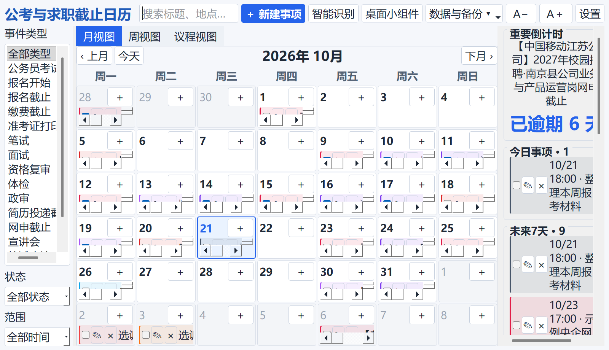

# 公考与求职截止日历

一款面向公务员考试备考与求职投递场景的本地优先桌面日历。它把报名、缴费、准考证打印、笔试、面试、资格复审、网申截止等分散节点，集中成一个每天都能快速扫一眼的时间控制台。

> 隐私说明：Windows 上的事项、设置与备份默认只保存在用户电脑的 `E:\公考求职日历数据`。若没有 E 盘则回退到 `%APPDATA%\ExamJobCalendar`。本仓库不包含任何用户日程、数据库或备份文件。



## 产品特点

- 月、周、议程三种视图，支持今天、未来 7 天和未来 30 天筛选
- 今日事项、重要考试倒计时、截止日倒计时与本月统计
- 公考及求职常用事项类型预设，并使用不同颜色区分
- 事项新增、编辑、删除、搜索、筛选、完成状态和优先级
- 粘贴公告正文后在本机自动识别报名、缴费、准考证、笔试等时间节点，确认后批量导入
- 日期格内支持横向与纵向滚动，事项可用“×”或右键菜单删除
- 未来事项面板可拖动分隔线调整宽度，并自动记住布局
- 自定义提醒，支持提前 7 天、3 天、1 天、2 小时、30 分钟
- 逾期事项高亮，并可持续提醒未完成事项
- 无边框桌面小组件，支持拖动、缩放、置顶、锁定位置和透明度
- 系统托盘与 Windows 开机启动
- 跟随系统的深色/浅色主题，以及自动或手动文字缩放
- 本地 SQLite 存储，支持 JSON / CSV / ICS 导出、JSON 导入及数据库备份恢复
- 无账号、无云端服务、无付费 API，核心功能可离线使用

## 快速开始

### 直接运行源码

需要 Windows 10/11 和 Python 3.10 或更高版本。

```powershell
python -m venv .venv
.\.venv\Scripts\Activate.ps1
python -m pip install -r requirements.txt
python main.py
```

不熟悉命令行时，也可以双击 `首次安装并启动.bat`。首次安装完成后，双击 `启动日历.bat` 即可启动。

### 打包 Windows EXE

```powershell
python build_exe.py
```

或者双击 `打包EXE.bat`。生成文件位于 `dist\公考求职日历.exe`。

## 数据位置

应用运行数据位于：

```text
E:\公考求职日历数据
├── calendar.db       # 事项数据库
├── settings.json     # 本机设置
├── backups\          # 自动和手动备份
└── calendar.log      # 错误日志
```

以上路径均已通过 `.gitignore` 排除，不会被提交到版本库。建议在公开提交前仍检查一次 `git status`，确认没有误加入任何导出的 JSON、CSV、ICS 或数据库文件。

## 项目结构

```text
main.py                         主程序与界面
build_exe.py                    PyInstaller 打包脚本
公考求职日历.spec               可复现的打包配置
update_recruitment_calendar.py  经核验招聘信息的安全入库工具
requirements.txt                Python 依赖
*.bat                           Windows 零命令行启动与打包脚本
docs/产品概念.md                产品定位、原则与演进方向
docs/隐私与本地数据.md          数据边界与公开仓库安全说明
docs/使用指南.md                新建、识别、提醒、布局与备份操作说明
docs/images/                    仅含演示事项的脱敏界面截图
```

## 当前定位

项目优先适配 Windows 11。代码保留 Qt 兼容层，未来可进一步验证和完善 macOS 支持。当前仓库未附带开源许可证，作者保留全部权利。

完整操作方法参见 [使用指南](docs/使用指南.md)。更多设计背景参见 [产品概念](docs/产品概念.md) 与 [隐私与本地数据](docs/隐私与本地数据.md)。

