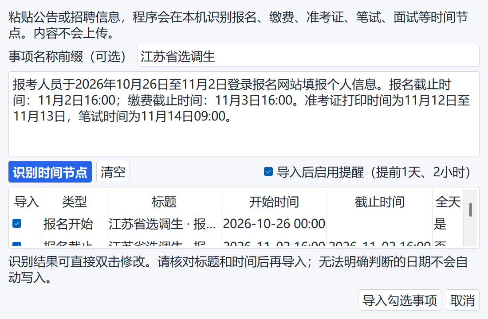

# 使用指南

本指南面向直接使用 Windows EXE 的用户。应用采用本地优先设计，不需要登录；事项、提醒和界面设置保存在自己的电脑中。

## 1. 主界面


主界面由四部分组成：

1. 顶部工具栏：搜索、新建事项、智能识别、桌面小组件、数据与备份、字号和设置。
2. 左侧筛选栏：按事项类型、状态和时间范围筛选。
3. 中部日历：可切换月视图、周视图和议程视图。
4. 右侧概览：显示重要倒计时、今日事项、未来 7 天与统计数据。

拖动中部日历与右侧概览之间的竖向分隔线，可以调整概览宽度；关闭应用后，宽度设置会自动保留。

## 2. 新建、编辑和删除事项

- 点击顶部“＋ 新建事项”，可以填写完整事项信息。
- 点击月视图日期格右上角“＋”，会自动带入当天日期。
- 点击事项旁的铅笔按钮可以编辑，点击“×”可以删除。
- 也可以在事项上点击鼠标右键，选择“编辑事项”或“删除事项”。
- 点击事项左侧复选框可以标记完成；已完成事项仍会保留，便于复盘。

日期格内容较多时，可使用格子内的横向和纵向滚动条查看完整标题及其他事项，日历整体尺寸不会被撑破。

## 3. 从公告文字智能识别时间节点



1. 点击顶部“智能识别”。
2. 粘贴考试公告或招聘公告正文。
3. 可填写事项名称前缀，例如“江苏省选调生”。
4. 点击“识别时间节点”。
5. 在结果表中核对类型、标题、开始时间、截止时间和全天状态；内容可双击修改。
6. 取消不需要项目的勾选，再点击“导入勾选事项”。

识别功能在本机使用日期表达式和关键词规则完成，不调用云端 AI，也不会上传公告内容。它适合识别报名开始、报名截止、缴费截止、准考证打印、笔试和面试等明确节点。公告写法复杂或年份不完整时，请务必在导入前人工核对。

## 4. 字号与界面布局

- 默认启用“文字随窗口自动调整”，缩放窗口时字号会同步适配。
- 点击右上角“A− / A＋”可以立即减小或增大字号，并切换为自定义字号。
- 在“设置”中可重新开启自动字号，或手动选择 10～22 磅。
- 右侧概览宽度可通过拖动分隔线调整。
- 桌面小组件支持拖动、缩放、置顶、透明度与位置锁定。

## 5. 提醒、托盘与开机启动

- 新建或编辑事项时可决定是否启用提醒，并选择提前 7 天、3 天、1 天、2 小时、30 分钟或自定义时间。
- 提醒依赖程序在后台运行。关闭主窗口后，程序会留在系统托盘。
- 双击托盘图标或按 `Ctrl + Alt + Space` 可呼出完整日历。
- 在“设置”中可开启 Windows 开机启动。
- 需要彻底退出时，请使用系统托盘菜单中的“退出程序”。

## 6. 数据、备份与恢复

默认数据目录：

```text
E:\公考求职日历数据
```

如果电脑没有 E 盘，程序会回退到：

```text
%APPDATA%\ExamJobCalendar
```

“数据与备份”菜单支持：

- 导出和导入 JSON；
- 导出 CSV；
- 导出 ICS 日历文件；
- 立即备份数据库；
- 从数据库备份恢复；
- 打开数据文件夹。

程序每日首次启动时会自动备份，并保留最近 20 份自动备份。恢复数据库前，也会先备份当前数据。

## 7. 隐私说明

应用核心功能不要求联网，用户的真实日程不会自动上传。本仓库中的界面截图使用专门生成的演示事项，不包含用户数据库、个人安排或真实求职记录。更多说明参见[隐私与本地数据](隐私与本地数据.md)。
